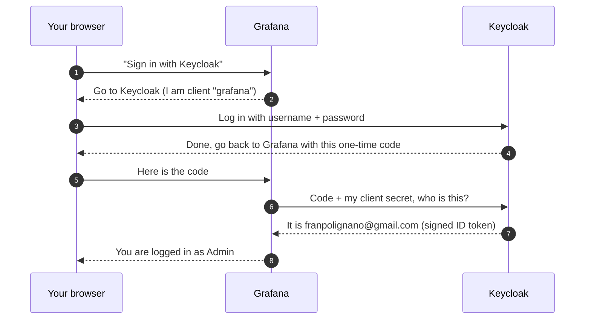

# keycloak

Keycloak 26 (pinned) at `keycloak.franpolignano.com` — the homelab's SSO
identity provider. Realm **`homelab`**, user **`fran`**. Data on Ceph with the
standard nightly NFS backup.

## How it works (plain-English refresher)

Keycloak is the one place in the lab that knows who you are. Every app that
supports SSO (ArgoCD, Grafana, Gitea, Immich, Open WebUI, weekly-sitrep) is
configured to **not** have its own login; instead it hands you to Keycloak,
Keycloak checks your password, and then tells the app "this is
`franpolignano@gmail.com`" in a signed message the app can trust. The protocol
is **OpenID Connect (OIDC)**, which is OAuth 2.0 plus an identity layer. The
specific variant every app here uses is the **Authorization Code flow**.

### Vocabulary, mapped to this lab

| Term | What it means here |
|---|---|
| **Identity provider (IdP)** | Keycloak at `https://keycloak.franpolignano.com` |
| **Realm** | A self-contained user database + settings. `homelab` holds user `fran` and all six app clients. `master` is only for Keycloak's own admin console. |
| **Client** | One app registered in a realm. `grafana`, `argocd`, `gitea`, `immich`, `open-webui`, `weekly-sitrep`. Each has a client ID (public name) and usually a client secret (password the app proves itself with). |
| **Redirect URI** | The app URL Keycloak is allowed to send you back to after login, e.g. `https://grafana.franpolignano.com/login/generic_oauth`. Registered per client so a stolen code can't be sent anywhere else. |
| **Public vs confidential client** | `argocd` is **public** (no secret) so the CLI and mobile app, which can't keep a secret, can log in. All others are confidential. |
| **Discovery URL** | `https://keycloak.franpolignano.com/realms/homelab/.well-known/openid-configuration`. A JSON document listing every endpoint below. Open WebUI and weekly-sitrep read this and need nothing else; Grafana has the three URLs spelled out in `grafana.yaml`. |
| **`/auth` endpoint** | Where the browser is sent to log in: `.../realms/homelab/protocol/openid-connect/auth` |
| **`/token` endpoint** | Where the *app* (server-side) swaps the one-time code for tokens: `.../protocol/openid-connect/token` |
| **`/userinfo` endpoint** | Optional: app asks "who does this token belong to?" |
| **ID token** | A signed JWT saying who logged in (`email`, `name`, `preferred_username`). The app reads this to create/match your account. |
| **Access token** | Bearer token the app holds for the session. Realm-wide lifespan **12 h** (raised from 5 min because ArgoCD never refreshes). |
| **Refresh token** | Lets the app silently get a new access token without a login prompt, as long as the Keycloak SSO session is alive. |
| **SSO session** | A cookie **on the Keycloak domain**, not on each app. Idle **14 d**, max **30 d**. This is why logging into Grafana then opening ArgoCD skips the password prompt: ArgoCD redirects to Keycloak, Keycloak sees its own cookie, and bounces you straight back. |

### The flow, using Grafana as the example

Six steps. The browser bounces between the two sites; the only thing it ever
carries from Keycloak to Grafana is a one-time code.



Step by step, with the real names:

1. You click "Sign in with Keycloak" on `grafana.franpolignano.com`.
2. Grafana redirects you to Keycloak's `/auth` endpoint for realm `homelab`,
   saying: client `grafana`, send the user back to
   `/login/generic_oauth` afterwards.
3. Keycloak shows the login page and checks the password itself. Grafana never
   sees it. **If you already logged into any other SSO app recently, this step
   is skipped**: Keycloak sees its own SSO cookie and goes straight to step 4.
4. Keycloak redirects you back to Grafana's callback URL with a one-time code.
5. Your browser delivers the code to Grafana.
6. Grafana, server to server, posts the code plus its client secret (from the
   out-of-band Secret `grafana-oidc`) to Keycloak's `/token` endpoint.
7. Keycloak answers with an ID token (who you are), an access token and a
   refresh token.
8. Grafana reads `email` from the ID token, applies its own rule
   (`franpolignano@gmail.com` = Admin, anyone else = Viewer), and sets its own
   session cookie.

What to notice:

- **Your password only ever goes to Keycloak** (step 3). Grafana never sees it.
- **The browser only carries a short-lived code** (steps 4 and 5). The real
  tokens move server-to-server in steps 6 and 7, which is why Grafana needs
  the client secret and why that secret lives out-of-band, not in git.
- **Authorization is still the app's job.** Keycloak only says *who*. Each app
  decides *what they can do*: Grafana via `GF_AUTH_GENERIC_OAUTH_ROLE_ATTRIBUTE_PATH`
  (email match → Admin), ArgoCD via `argocd-rbac-cm` (`g, franpolignano@gmail.com, role:admin`),
  Gitea/Immich/Open WebUI by auto-creating an account on first login and
  using their own per-user settings after that.
- **Logging out of an app does not log you out of Keycloak.** The SSO cookie
  keeps you signed in for the other apps until it idles out at 14 d, unless
  the app also calls Keycloak's `/logout` endpoint.

### Same flow, other apps

| App | How the app is told about Keycloak | Where you land after login |
|---|---|---|
| ArgoCD | `argocd-cm` `oidc.config` (issuer + clientID), applied with kubectl | `https://argocd.franpolignano.com/auth/callback` (also `localhost:8085` for the CLI, `argocd://` for mobile) |
| Grafana | `GF_AUTH_GENERIC_OAUTH_*` env in `grafana.yaml` | `/login/generic_oauth` |
| Gitea | Auth source stored in Gitea's DB (`gitea admin auth list`) | `/user/oauth2/keycloak/callback` |
| Immich | System config set via the admin API (`PUT /api/system-config`) | `/auth/login` (also `app.immich:///oauth-callback` for the mobile app) |
| Open WebUI | `OPENID_PROVIDER_URL` = discovery URL, in `open-webui.yaml` | `/oauth/oidc/callback` |
| weekly-sitrep | `OIDC_DISCOVERY_URL` in `weekly-sitrep.yaml` | `/auth/callback` |
| keycloak-demo-app | Browser-only demo (`demo-app` client) that prints each step live. Open it when you want to *watch* the flow above happen. | `192.168.40.201:8086` |

### When something breaks, where to look

1. **"Invalid redirect URI"** on the Keycloak login page: the app's callback
   URL is not in that client's *Valid redirect URIs* list in the admin console.
2. **Login loops or "invalid client credentials"**: the client secret in the
   app's out-of-band Secret no longer matches Keycloak (Clients → Credentials).
3. **Logged out after exactly N minutes everywhere**: realm token/session
   lifespans were reset (e.g. realm rebuild). Re-run the REST call in
   [Realm session settings](#realm-session-settings-changed-2026-07-16-token-lifespan-2026-08-20).
4. **Pods can't reach `keycloak.franpolignano.com`**: CoreDNS forward zone for
   `franpolignano.com` → Pi-holes is missing (not in git; kubeadm upgrades can
   drop it). The apps call Keycloak's public hostname from inside the cluster
   in step 9, so cluster DNS must resolve it to the gateway.

## Secret (applied out-of-band, NOT in git)

Bootstrap admin credentials live in Secret `keycloak-admin-creds` (only read
on a fresh-database first boot; the live password is in Keycloak's DB).
`secret.yaml` is gitignored. Template:

```yaml
apiVersion: v1
kind: Secret
metadata:
  name: keycloak-admin-creds
  namespace: keycloak
type: Opaque
stringData:
  username: "admin"
  password: "REPLACE_ME"
```

## SSO clients (realm `homelab`)

Client secrets live in Keycloak (admin console → Clients → Credentials) and
in each consumer's out-of-band Secret:

| Client | App config | Secret (out-of-band) |
|---|---|---|
| `argocd` | `argocd-cm` `oidc.config` + `argocd-rbac-cm` (managed out-of-band, kubectl) | key `oidc.keycloak.clientSecret` in `argocd-secret` |
| `grafana` | env in `workloads/grafana/grafana.yaml` | `grafana-oidc` in ns `monitoring` |
| `gitea` | auth source in Gitea DB (`gitea admin auth list`) | in Gitea's DB |
| `immich` | system config via Immich admin API/UI | in Immich's DB |
| `open-webui` | env in `workloads/open-webui/open-webui.yaml` | `openwebui-oidc` in ns `open-webui` |
| `weekly-sitrep` | env in `workloads/weekly-sitrep/weekly-sitrep.yaml` (client also allows `http://localhost:8000/auth/callback` for local dev) | `weekly-sitrep-oidc` in ns `weekly-sitrep` |

On a Keycloak rebuild: recreate realm `homelab`, user `fran`, and the six
clients (redirect URIs are `https://<app hostname>/<provider callback>`; the
`argocd` client additionally allows `http://localhost:8085/auth/callback` for
the CLI and `argocd://auth/callback` for the mobile app, and is a **public**
client — no client secret required, so the mobile app can log in), then
refresh each consumer's secret. Or restore the nightly backup, which includes
the Keycloak DB.

## Realm session settings (changed 2026-07-16, token lifespan 2026-08-20)

Defaults (30 min idle / 10 h max) forced a re-login on every app after half
an hour away. Now: **SSO Session Idle 14 d, Max 30 d, Remember Me on,
Access Token Lifespan 12 h** — set via the admin REST API (admin password:
`cluster/keycloak-credentials.txt`; Keycloak has no realm-settings CLI
in-container, the API is the scriptable path):

```sh
TOKEN=$(curl -fsS "https://keycloak.franpolignano.com/realms/master/protocol/openid-connect/token" \
  -d client_id=admin-cli -d username=admin -d "password=$KC_ADMIN_PASS" \
  -d grant_type=password | jq -r .access_token)
curl -fsS -X PUT "https://keycloak.franpolignano.com/admin/realms/homelab" \
  -H "Authorization: Bearer $TOKEN" -H "Content-Type: application/json" \
  -d '{"ssoSessionIdleTimeout": 1209600, "ssoSessionMaxLifespan": 2592000, "rememberMe": true, "accessTokenLifespan": 43200}'
```

Access-token lifespan was left at the 5-min default until 2026-08-20 on the
theory that tokens renew silently while the SSO session is alive — true for
apps that use refresh tokens (Grafana/Gitea/Immich), but **ArgoCD's UI never
refreshes**: its session dies with the token, which logged Fran out every
5 minutes. 12 h realm-wide fixes it everywhere (tradeoff: a stolen bearer
token stays valid up to 12 h — fine on the LAN). Re-apply after any realm
rebuild — this is not in the realm defaults.

No SSO (no native OIDC): plex, jellyfin*, radarr/sonarr/sabnzbd, tautulli,
metube, heimdall, prometheus, frigate, ELK (paid feature), ceph dashboard
(SAML only), navidrome (reverse-proxy header auth only). *jellyfin has a community SSO plugin if ever wanted.
